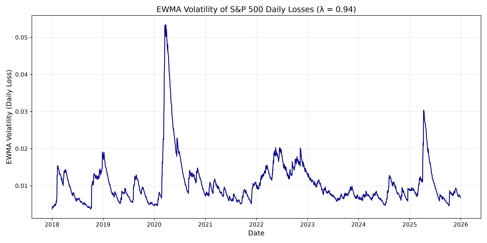
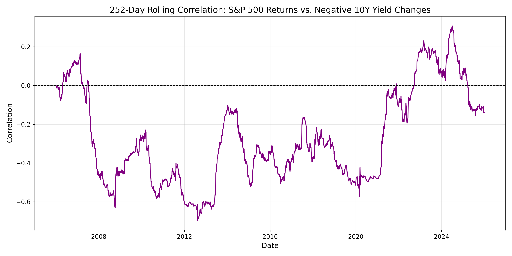
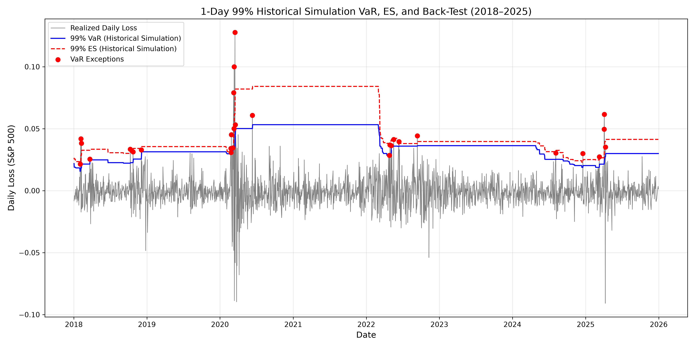

# Risk Assessment for Asset Management Firm: S&P 500 Equity Risk (2018–2025)

**Paulo Jose Araujo**

Department of Finance and Business Economics  
Faculty of Business Administration  
University of Macau 

**Course:** FINC7035: Financial Risk Management  
**Instructor:** Jiahong Shi  
**Program:** Master Program (2026 Autumn)  
**Date:** October 30, 2026

---

**MEMORANDUM**

**To:** Chief Risk Officer  
**From:** Paulo Jose Araujo  
**Date:** October 30, 2026  
**Re:** Risk Assessment for Asset Management Firm: S&P 500 Equity Risk (2018–2025)

---

## 1. Introduction and Exposure
This memo presents a quantitative risk assessment for an Asset Management Firm managing diversified investment portfolios. The firm’s core objective is to generate total return for clients while managing volatility and protecting capital against severe drawdowns. Because equity exposure is the primary driver of portfolio performance and the main source of downside risk, the chosen primary risk factor for this analysis is the daily log return of S&P500 Price Index. 

To model risk accurately from the perspective of a long-only equity exposure, I define a daily loss series where a larger positive value represents a worse outcome. The daily loss is calculated as the negative daily log return on the S&P 500 (‘primary_loss = -SP500_logret’). By flipping the sign, a 2% drop in the equity market is recorded as a positive 2% loss. This transformation allows me to apply standard tail-risk model such as Value at Risk (VaR) and Expected Shortfall (ES) to measure the severity of potential drawdowns. 

Understanding this exposure is critical for the firm. Severe equity market downturns directly weaken client capital, which can trigger mass redemptions, damage the firm’s reputation, and reduce assets under management (AUM). The following sections analyze this risk through three distinct lenses: recent volatility dynamics, the changing correlation between stocks and government bonds, and the performance of my tail-risk models during recent market crises. 

## 2. Volatility Risk (EWMA Analysis)
The EWMA volatility analysis (Figure 1) reveals two distinct volatility patterns that are materially relevant to our firm's equity exposure. First, the March 2020 shock demonstrates the danger of extreme magnitude. Within a matter of weeks, EWMA volatility spiked from a baseline of roughly 0.005 to over 0.05. For an asset management firm, a spike of this size represents immediate, severe drawdowns across client portfolios. The sheer speed of this volatility increase means the firm cannot adjust its risk exposure quickly enough, forcing portfolio managers to either sell assets into a falling market to meet client redemptions or risk breaching internal risk limits.

Second, the 2022–2023 period illustrates the danger of duration. Unlike the sharp shock of 2020, volatility remained persistently elevated (hovering between 0.015 and 0.02) for well over a year. For an asset manager, a prolonged period of high volatility is arguably more damaging than a short spike. It persistently drags down risk-adjusted returns, makes strategic rebalancing expensive, and increases tracking error against benchmarks. This sustained underperformance can ultimately lead to client attrition and reputational damage. The brief 2025 spike serves as a final reminder that volatility regimes can shift rapidly, warning against complacency during periods of market calm.

## 3. Diversification Risk (Stock-Bond Correlation)
*(Summarize Session 3 notes here. Insert figure placeholder).*
- Explain the pre-2021 negative correlation and why it validated the 60/40 portfolio.
- Explain the 2021-2023 positive correlation spike. What did this mean for the firm? (Stocks and bonds falling together, no safe haven, balanced portfolios suffered severe drawdowns).
- Mention the recent normalization but emphasize the lesson: diversification is not guaranteed.
- 

## 4. Tail Risk and Model Performance (VaR, ES, and Back-Test)
*(Summarize Sessions 4 & 5 notes here. Insert figure placeholder).*
- State the method: 1-day 99% Historical Simulation, 500-day rolling window.
- Report the results: 29 exceptions vs 20.1 expected.
- Discuss the clustering of exceptions (March 2020, 2022, 2025). Why is clustering dangerous for an asset manager? (Model fails exactly when you need it most).
- Discuss the model lag: Historical simulation is reactive, not predictive. 
- Discuss ES vs VaR: ES is always higher, and the gap widens during stress.
- 

## 5. Risk Management Implications and Limitations
- **Main Implication:** The firm cannot rely solely on historical simulation for tail risk. The model lags during regime shifts. The firm should consider using stress testing (e.g., hypothetical scenarios) or combining historical simulation with models that react faster to volatility (like EWMA or GARCH). Also, the breakdown of stock-bond correlation means asset allocation must be dynamic, not static.
- **Important Limitation:** Historical simulation assumes the past 500 days represent the future. It does not adapt quickly to new regimes. Additionally, the stock-bond correlation uses a yield-change proxy, not actual bond returns, which may slightly misrepresent the true diversification benefit.
